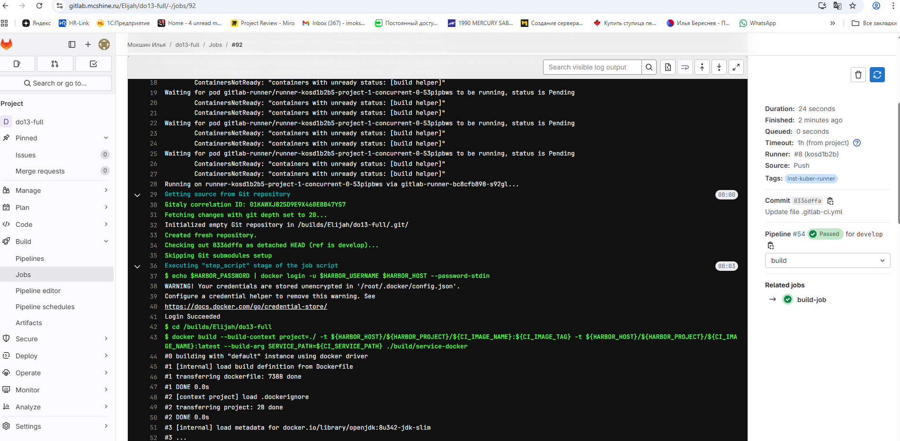
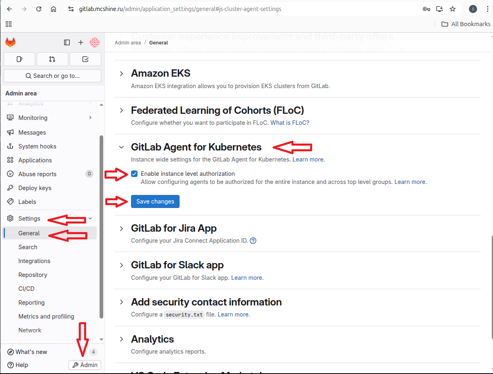
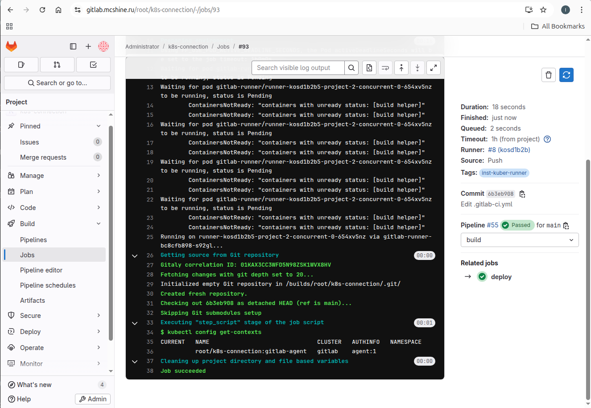
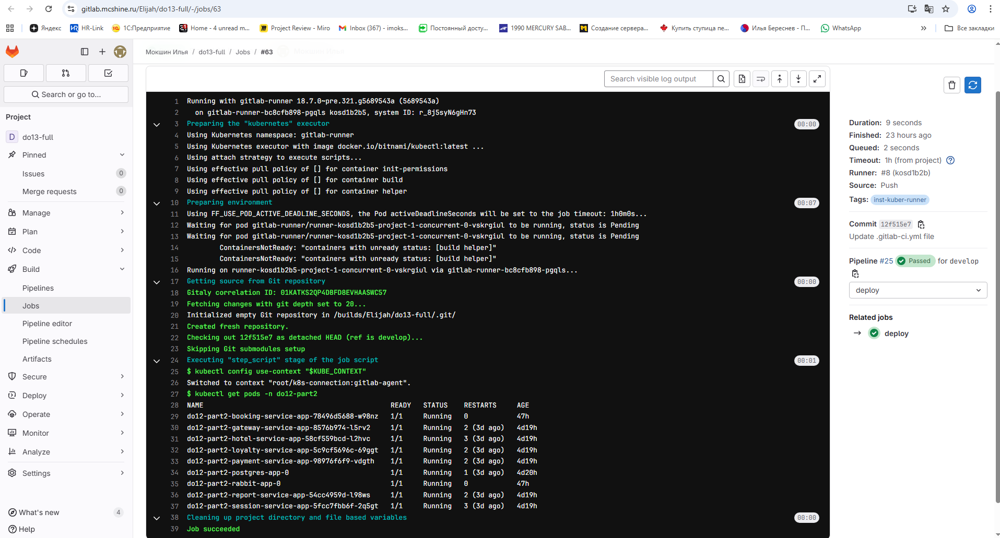
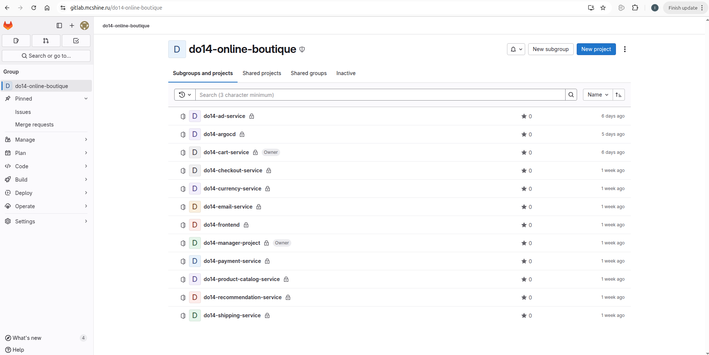
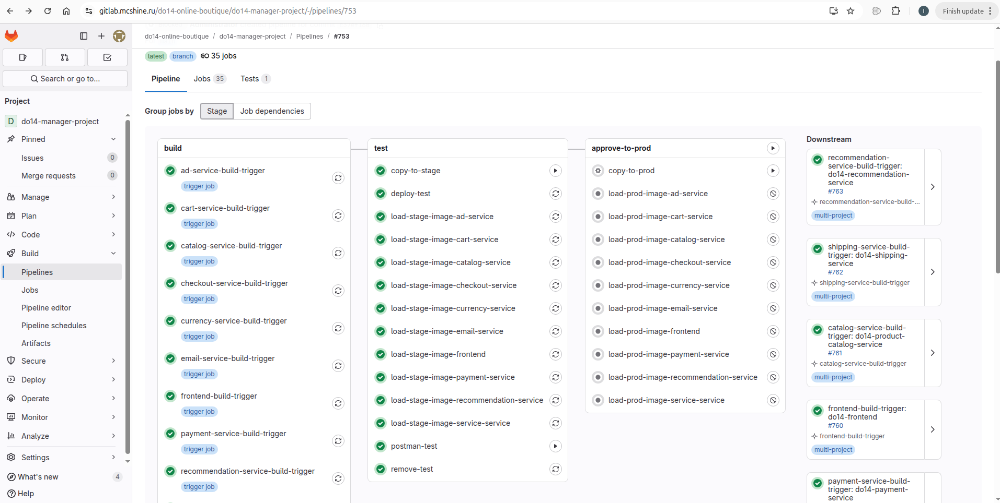
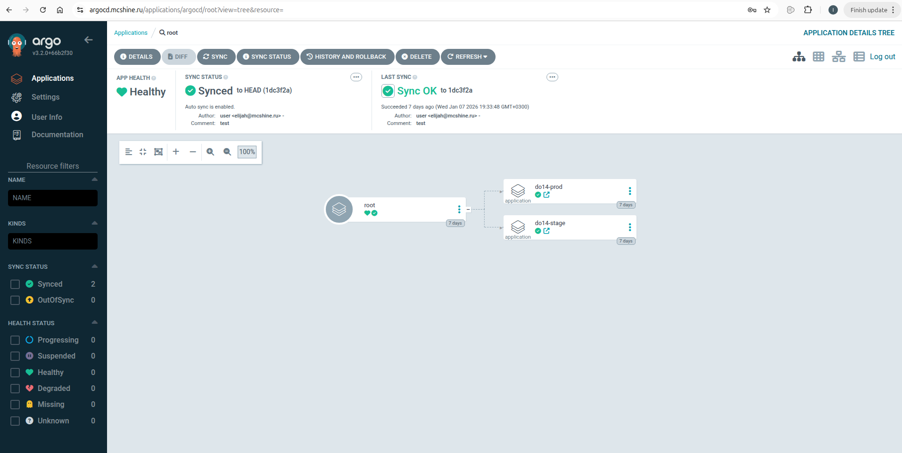
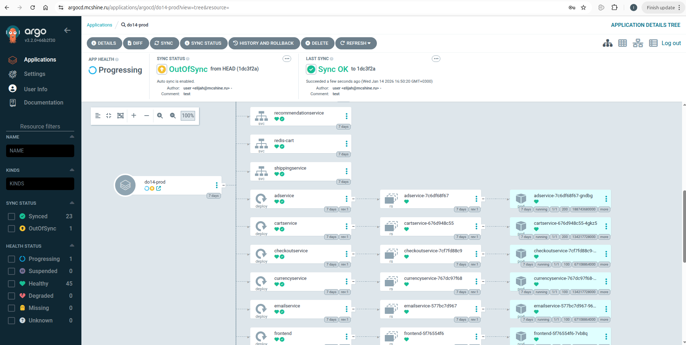
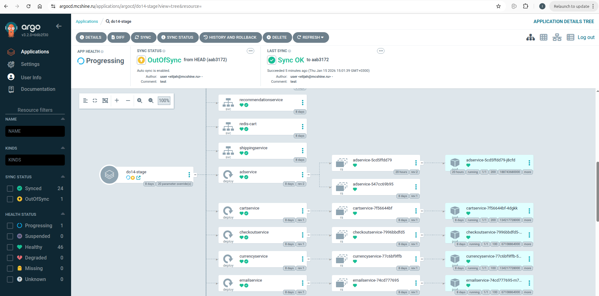

## Часть первая. Общие положения

Как написано в самом задании, пришло время собрать всю волю в кулак, сконцентрировать все накопленные за курс знания в финальном проекте и чего-то там еще.

В общем, в качестве объекта для проета мы выбрали пример микросервисного приложения от Гугла "Онлайн бутик":\
https://github.com/GoogleCloudPlatform/microservices-demo/tree/main

Оно хорошо всем - есть фронтэнд, связи между разными сервисами, база данных и, что крайне интересно, сервисы написаны на разных языках. Т.е. можно сэмулировать почти реальную картину, когда разные команды, возможно даже в разное время, пишут, переписывают и дописывают проект.

Более того, вместе в пачкой сервисов идет и Хельмчарт, и полностью инструкция как енто всё собрать. И, по сути, такое задание ничем не отличается от 13го.

Поентому, с одной стороны, мы отступим от правил школьного задания, а с другой, сделаем задание чуть интереснее, сложнее, и даже, не побоимся ентого слова, правильнее.

Вот давайте порассуждаем, десяток сервисов, написанных на разных языках - что енто значит? Енто значит либо одинаково пишущего на разных языках погроммиста, либо, что более реально, несколько различных команд. Что означает несколько различных групп людей? Возможные конфликты, желание подпортить жЫзнь ближнему (и не очень) своему, ну и банальный человеческий фактор - возможность ошибки, после которой восставление хотябы последнего состояния будет процессом не быстрым.

Данный аспект жизнедеятельности стартапа/предприятия/команды мы еще не рассматривали на ветке ДО. Поентому в данном заднии попробуем подойти с точки зрения решения некоторых проблем бозопасности.

Будем работать по принципу "разделяй и властвуй". Будем давать доступ к определенным ресурсам только тем, кому надо, и вообще, разделим енти самые ресурсы.\
Первое - каждый микросервис будет отдельным проектом в гитлабе и можно будет выдавать доступ к ним определенной команде. Процесс CI будет выведен в отдельный проект, а доступ к нему будет у ответственного лица - манагера проекта, или кому там енто поручат. А процесс СD, как можно догадаться тоже будет в отдельном проекте, а доступ к нему будет разве что у девопёсов.

Вот оно - наше некоторое усложнение. Но енто заставляет нас отступить от правил рыботы со школьным Гитлабом, так как надо больше правов.

Поентому мы будем делать проект на своем Гитлабе, со своим Кубером, и Харбором, переделаем идущий с микросервисами Хельм чарт и выложим на школьный гит только отчет, ну и исходники.

## Часть вторая. Подготовка инфраструктуры, связка кластера и гитлаба

### Сборка

Тут мы поговорим о том, как прифигачить к кластеру раннер и какими способами осуществлять деплой.

Раннер - енто некий агент, который занимается выполнением инструкций пайплайна. Основных условных типов ентого агента два. Shell раннер имеет права на использование командной строки того сервера, где он установлен. А docker раннер создает контейнер определенного образа и использует командную строку контейнера.

Кубер имеет специфический раннер второго типа. Енто, типа, удобно, так как нет привязки не то, чтобы к серверу и его командной строке, но даже нет привязки к докеру на определенном сервере. Контейнеры (поды) создаются в кластере.

Тут нужно еще небольшое примечание. Многие дополнительные инструменты могут быть присоединены индивидуально к проекту, или к всему серверу гитлиба (инстансовые).\
Мы будем, поскольку есть такая возможность, настраивать инстансовые сущности.

Но, по сути, оно там все одинаково делается.

В нашем случае, мы заходим в гитлаб админом, и нажимаем кнопку админки:


Далее, как и в проектном раннере, выбираем CI/CD -> Runners, но тут у нас есть кнопка, которая так и называется, создать инстансовый раннер:


Далее, гитлаб создает раннер, и показывает нам токен для подключения. Его мы копируем. Еще тег пропишем и запретим обработку нетегированных задач.

Теперь осталось только подключиться. 

Поскольку нам надо раннер в кубернетесе, то лезем читать пару ссылок:

https://docs.gitlab.com/runner/executors/kubernetes/ - енто в принципе про возможности и настройки кубер реннера.

https://docs.gitlab.com/runner/install/kubernetes/ - енто про установку с помощью helm.

Использовать второй вариант не возбраняется.

Посмотрим, что нужно добавить в values.yaml.
```
gitlabUrl: Указываем адрес нашего гитлаба.
runnerToken: И токен в открытом виде. В секрет он его переведет сам.
```

По идее всё, но лучше сделать еще нексолько настроек. И первая - RBAC, для разграничения прав и доступа:
```
rbac:
  create: true
  rules:
    //Тут описываем, на что мы дадим права учетной записи раннера.
    - apiGroups: [""]
      resources: ["pods"]
      verbs: ["list", "get", "watch", "create", "delete"]
    - apiGroups: [""]
      resources: ["pods/exec"]
      verbs: ["create"]
    - apiGroups: [""]
      resources: ["pods/log"]
      verbs: ["get"]
    - apiGroups: [""]
      resources: ["pods/attach"]
      verbs: ["list", "get", "create", "delete", "update"]
```

Мы выдали пачку прав на действия с подами, так как раннер должен будет только собирать образы и пушить на докерхаб (харбор в моем случае).\
Никаких правов на сервисы и неймспейсы ему не надыть давать. Разворачивать мы будем другой образой.

Что еще можно добавить?\
Сам файл config.toml хельмом собирается на этапе поднятия пода раннера из конфигов и файле values.yaml на енто можно повлиять:
```
  //Часть имеющаяся по умолчанию:
  config: |
    [[runners]]
      [runners.kubernetes]
        namespace = "{{ default .Release.Namespace .Values.runners.jobNamespace }}"
        //Допишем ниже несколько строк
        //Образ по умолчанию
        image = "docker.io/docker:latest"
        //Иногда может возникнуть проблема с дополнительным контейнером, который раннер добавляет в наш под,
        //что-бы тот отслеживал статус и выполнение нашего основного контейнера.
        //Проблема заключается в том, как раннер собирает имя образа хелпера. А потом вопит, 
        //что не может его найти и скачать.
        //Поентому выберем образ посвежее и укажем туть.
        helper_image = "registry.gitlab.com/gitlab-org/gitlab-runner/gitlab-runner-helper:alpine3.19-x86_64-v18.6.1-pwsh"
        //Поскольку мы докер в контейнере, то может возникнуть проблема с работой самого ентого докера,
        //так как он не сможет поднять сокет.
        //Поможем ему с ентим, и пробросим сокет с сервера.
        [[runners.kubernetes.volumes.host_path]]
          host_path = '/var/run/docker.sock'
          mount_path = '/var/run/docker.sock'
          name = 'docker-sock'
          read_only = true
```

Устанавливаем, проверяем коннект и начнем писать мега простой пайплайн для теста работы.

```
variables:
  //Зададим параметры нашему будущему образу
  CI_IMAGE_NAME: "test-booking-service"
  CI_IMAGE_TAG: "0.0.1"
  //Путь, относительно контекста, откуда копировать исходники сервиса
  CI_SERVICE_PATH: "./src/services/booking-service"
  //Нам надо залогиниться на наш докер хаб
  CI_REGISTRY: "docker.mcshine.ru/library"
  CI_REGISTRY_PASSWORD: "docker-password"
  CI_REGISTRY_USER: "docker-user"

default:
  tags:
    //Теги для раннера
    - inst-kuber-runner

stages:
  - build

build-job:
  stage: build
  image: docker.io/docker:latest
  //Прежде всего, надо залогиниться. Если не пройдет, то и собирать образ не имеет смысла.
  before_script:
    - echo $CI_REGISTRY_PASSWORD | docker login -u $CI_REGISTRY_USER $CI_REGISTRY --password-stdin
  script:
    - cd /builds/Elijah/do13-full
    //Собираем образ сразу с двумя тегами
    - docker build --build-context project=./ -t ${CI_REGISTRY}/${CI_IMAGE_NAME}:${CI_IMAGE_TAG} -t ${CI_REGISTRY}/${CI_IMAGE_NAME}:latest --build-arg SERVICE_PATH=${CI_SERVICE_PATH} ./build/service-docker
    //Закидываем на гитхаб
    - docker push ${CI_REGISTRY}/${CI_IMAGE_NAME}:${CI_IMAGE_TAG}
    - docker push ${CI_REGISTRY}/${CI_IMAGE_NAME}:latest
    - echo "Compile complete."
```

Теперь немного поговорим об удобстве и фичах гитлаба.\
Если мы залезем в Settings -> Integrations, то мы увидим, что гитлаб можно много к чему подключить. Мы подключили Харбор.


И теперь переменные CI_REGISTRY, CI_REGISTRY_PASSWORD и CI_REGISTRY_USER нам не нужны. У нас, заместо них, есть $HARBOR_USERNAME, $HARBOR_HOST, $HARBOR_OCI, $HARBOR_PASSWORD, $HARBOR_URL и $HARBOR_PROJECT.

Немного перепишем наш пайплайн:
```
variables:
  CI_IMAGE_NAME: "test-booking-service"
  CI_IMAGE_TAG: "0.0.1"
  CI_SERVICE_PATH: "./src/services/booking-service"

default:
  tags:
    - inst-kuber-runner

stages:
  - build

build-job:
  stage: build
  image: docker.io/docker:latest
  before_script:
    - echo $HARBOR_PASSWORD | docker login -u $HARBOR_USERNAME $HARBOR_HOST --password-stdin
  script:
    - cd /builds/Elijah/do13-full
    - docker build --build-context project=./ -t ${HARBOR_HOST}/${HARBOR_PROJECT}/${CI_IMAGE_NAME}:${CI_IMAGE_TAG} -t ${HARBOR_HOST}/${HARBOR_PROJECT}/${CI_IMAGE_NAME}:latest --build-arg SERVICE_PATH=${CI_SERVICE_PATH} ./build/service-docker
    - docker push ${HARBOR_HOST}/${HARBOR_PROJECT}/${CI_IMAGE_NAME}:${CI_IMAGE_TAG}
    - docker push ${HARBOR_HOST}/${HARBOR_PROJECT}/${CI_IMAGE_NAME}:latest
    - echo "Compile complete."
```

Запустим. Ждем. Видим единственную джобу. Завершилась успешно.


Судя отчету, проблем не возникло.



### Развертывание

Вот у нас есть образ/образы, как нам енто развернуть?

Чего может быть проще? Идем на кластер, вбиваем хельм инстралл и алга.

Но нам же надо автоматизацию. Вот и давайте пораскинем мозгами (только не так, как пассажир Джулса Уиннфилда и Винсента Веги в Криминальном чтиве) и подумаем, какие варианты у нас есть.
1. Можно сделать еще один раннер, но shell прямо на сервере/серверах кластера.

Вариант не дурной (на крайний случай). Мы получаем прямой доступ к командной строке одного из серверов кластера в полное управление. Особенно, если пользователю раннера дадим полные права. Но жЫрный минус - либо ставим на все ноды кластера, либо надеемся, что та, с которой разворачиваем, не упадет.

2. Использовать образ в которм есть kubectl.

Собрать его самим, если паранойя шалит, или использовать, к примеру, bitnami/kubectl:latest - дело ваше.\
Останется только вопрос, как логиниться к куберу с ентого kubectl.

Тут от гитлаба нам подгон - gitlab-agent для кубера.\
Официальная документация, тык туда - https://docs.gitlab.com/user/clusters/agent/ci_cd_workflow

Устанавливается он не сложно. В нашем проекте тыкаем Operate -> Kubernetes clusters -> Connect a cluster


Далее вылезет окошко, где предложат выбрать имя нашему агенту, и выкатят инструкцию, как его установить.


После установки надо будет создать папку для конфига агента (отмечено через скрин выше).\
Прелесть в том, что мы можем создать пустой проект только для агента, и в конфиге указывать те проекты, которым даем доступ на использование агента:
```
ci_access:
  projects:
    - id: Elijah/do13-full
```

Или, мы можем сделать агент инстансовым. Для ентого делаем следующее. В конфиге агента пишем так:
```
ci_access:
  instance: {}
```

Далее лезем в админку, Settings -> Generalь -> GitLab Agent for Kubernetes, ставим галочку, мол разрешить инстансовые агенты, и схороняем.



Теперь попробуем что-то сделать в самом проекте с присоединенным агентом. Первым делом узнаем контекст кубера:
```
default:
  tags:
    - inst-kuber-runner

stages:
  - build

deploy:
  image: docker.io/bitnami/kubectl:latest
  stage: build
  script:
    - kubectl config get-contexts
```

И вот мы видим, что нам надо использовать root/k8s-connection:gitlab-agent



Теперь в другом, микросервисовом проекте, попробуем воспользоваться данным агентом:
```
default:
  tags:
    - inst-kuber-runner

stages:
  - deploy

deploy:
  image: docker.io/bitnami/kubectl:latest
  variables:
    KUBE_CONTEXT: root/k8s-connection:gitlab-agent
  stage: deploy
  script:
    - kubectl config use-context "$KUBE_CONTEXT"
    - kubectl get pods -n do12-part2
```

И, да. Оно работает. У нас есть доступ к кластеру из контейнера, который находится в поде на ентом же кластере.




## Часть третья. Начинаем начинать

Создадим в ГитЛабе группу проектов от имени девопсов и назовем ее "do14-online-boutique".
И создадим проекты, необходимые для работы:

    Микросервисы нашего сервиса:
    - do14-ad-service
    - do14-cart-service
    - do14-checkout-service
    - do14-currency-service
    - do14-email-service
    - do14-frontend
    - do14-payment-service
    - do14-product-catalog-service
    - do14-recommendation-service
    - do14-shipping-service

    Проект для сборки (CI):
    - do14-manager-project

    А разворачивать будем через замечательный, великолепный ArgoCD и для ентого тоже сделаем проект:
    - do14-argocd



### Логика запуска пайплайнов

Тут надо отдельно проговорить, как мы решили обозначить саму логику запуска пайнлайна и указать, чем мы ограничены, а где можем веселее развернуться.

Во-первых, не работает та метода, которой мы пользовались в 13м проекте, когда мы запускали пайплайн только если были изменения в папке "src/**/*". Объясняем. Если мы передаем часть ответственности за сборку и деплой менеджеру и снимаем ее с погроммистов, то следует учесть тайминг - от пайплайна до пайплайна в одном проекте может произойти несколько коммитов и нельзя исключать ситуацию, когда было три коммита с изменениями, а потом кто-то в шутку сделал коммит без изменений в "src". Тогда пайплайн пропустит сборку данного микросервиса.

Да, можно забить на оптимизацию и пересобирать образ при каждом пайплайне, но мы решили енту задачу следующим алгоритмом:
1. Конкретно обозначенные погроммисты в период спринта клепают конкретный микросервис в конкретном проекте в отдельной ветке, так как у них нет доступа в основную ветку.
2. Потом запускают мердж реквест (или не запускают, если нет обновлений проекта).
3. Потом ответственное лицо запускает пайплайн, который находится в отдельном проекте (do14-manager-project).
4. Пайплайн в первую очередь пытается собрать образы из исходников. Для ентого он:
- Создает отдельные задачи для всех микросервисов, и смотрит на название последнего коммита.
- Если оно не является специальным словом (у нас енто "triggered"), то можно собирать образ, а если же имя коммита "triggered", то енто значит, что с последнего пайплпана не было внесено изменений, и образ можно не собирать.
- Если же образ собирается, мы его заливаем на докерхаб проект для сырых, непроверенных образов, вносим об ентом некоторую информацию и спец файлик в прокте и делаем коммит в названием "triggered".
5. Запускаем автоматически некоторые автотесты. Для ентого собираем среду на кубере. Главное, не зависимо от результата, потом ентот деплой не забыть грохнуть.
6. Ответственное лицо, в зависимости от результатов тестов, принимает решение о переносе (одобрении) образов на докерхаб проект для образов для стейджа.
7. Через некоторое время ответственное лицо можно запустить процесс преноса образов из стейджа для релиза в прод.

### Шаблон для проектов микросервисов

Во-первых, заведем несколько специфичных папок в каждом проекте. В "src" будут лежать исходники, а в папке "build" будем хранить информацию для сборки (dockerfile).

А пайплайн для всех проектов будет одинаковый:
```
workflow:
  rules:
    - if: $CI_PIPELINE_SOURCE == "pipeline"
      when: always
    - when: never

include:
  - project: do14-online-boutique/do14-manager-project
    ref: main
    file: $CI_PIPELINE_FILE
```

Вот и всё.

Объясним, что тут происходит.
1. Пайплайн запускается только при запуске его по триггеру из внешнего проекта.
2. Сам пайплайн собирается из шаблонного файла, который тоже находится во внешнем проекте.
3. Более того, контретный путь к конкретному шаблону пайплайна передается по переменной.

Т.е. погроммист не видит, что делает пайплайн, более того, путь к шаблону не статичен, и мы могем запускать много раз пайплайн, указывать другой файл, и разные пайплайны будут творить разную дичь.

### Сборка

Нам нужен триггер, который заставит начинать работу пайплайн в проекте. Таких нам надо написать для каждого микросервиса:
```
ad-service-build-trigger:
  stage: build
  variables:
    //Тут укажем какой файл станет расширением пайплайна микросервиса
    CI_PIPELINE_FILE: gitlab-ci/build-extend.yml
  trigger:
    project: do14-online-boutique/do14-ad-service
    branch: develop
    strategy: mirror
```

Но, поскольку нам надо таких десяток, то давайте переведем дело в шаблон, как мы уже не раз делали:
```
.build-trigger-template:
  stage: build
  variables:
    //Тут укажем какой файл станет расширением пайплайна микросервиса
    CI_PIPELINE_FILE: gitlab-ci/build-extend.yml
  trigger:
    //Передадим переменной путь до проекта микросервиса
    project: do14-online-boutique/${SERVICE}
    branch: develop
    strategy: mirror

ad-service-build-trigger:
  extends: .build-trigger-template
  variables:
    SERVICE: do14-ad-service

cart-service-build-trigger:
  extends: .build-trigger-template
  variables:
    SERVICE: do14-cart-service
```

Теперь перейдем к разбору шаблона сборки build-extend.yml:
```
default:
  tags:
    //Укажем раннер. Тут не объязательно должен быть инстансовый раннер
    - inst-kuber-runner

variables:
  //Путь, он же название образа
  CI_IMAGE_NAME: "${HARBOR_HOST}/do14build/${SERVICE}"

stages:
  - build
  - commit

//Если коммит называется не "triggered":
build-image:
  stage: build
  image: docker:latest
  rules:
    - if: $CI_COMMIT_TITLE != "triggered"
  before_script:
    //Для образов теста и стейджа тег будет временной меткой вроде "25.11.30.14.47" год-месяц-день-час-минута
    //Но, к сожалению, стандартное "date -d ${CI_COMMIT_TIMESTAMP} +%y.%m.%d.%H.%M" не всегда работает (к примеру на Alpine)
    //Поентому - оффсет
    - TS=${IMAGE_TIMESTAMP}
    - CI_IMAGE_TAG="${TS:2:1}${TS:3:1}.${TS:5:1}${TS:6:1}.${TS:8:1}${TS:9:1}.${TS:11:1}${TS:12:1}.${TS:14:1}${TS:15:1}"
    //Логинимся в Харбор
    - echo $HARBOR_PASSWORD | docker login -u $HARBOR_USERNAME $HARBOR_HOST --password-stdin
  script:
    //Собираем, заливаем
    - docker build -t ${CI_IMAGE_NAME}:${CI_IMAGE_TAG} -t ${CI_IMAGE_NAME}:latest --build-context project=./src ./build/
    - docker push ${CI_IMAGE_NAME}:${CI_IMAGE_TAG}
    - docker push ${CI_IMAGE_NAME}:latest

make-commit:
  stage: commit
  image: ubuntu:latest
  rules:
    - if: $CI_COMMIT_TITLE != "triggered"
  before_script:
    //Подключаемся к проекту, из пайплайна проекта, для изменения файлов проекта, во время пайплайна проекта
    - apt-get update && apt-get install -y git >/dev/null
    - git config --global user.email ${GITLAB_USER_EMAIL}
    - git config --global user.name ${GITLAB_USER_NAME}
    - git remote set-url origin https://oauth2:${CI_PIPELINE_ACCESS}@${CI_PROJECT_URL#https://}.git
  script:
    //Запишем некоторую информацию
    - mkdir -p gitlab-ci
    - echo "---" >> ./gitlab-ci/ci-status.txt
    - echo "Commit title " $CI_COMMIT_TITLE >> ./gitlab-ci/ci-status.txt
    - echo "Commit sha " $CI_COMMIT_SHA >> ./gitlab-ci/ci-status.txt
    - echo "Commit date " $CI_COMMIT_TIMESTAMP >> ./gitlab-ci/ci-status.txt
    - echo "Image time " $IMAGE_TIMESTAMP >> ./gitlab-ci/ci-status.txt
    - git add -A
    //Вот он наш коммит "triggered"
    - git commit -m "triggered" --allow-empty
    - git push origin -o ci.skip HEAD:develop

//Если коммит называется "triggered":
info-job:
  stage: commit
  image: ubuntu:latest
  rules:
    - if: $CI_COMMIT_TITLE == "triggered"
  script:
    //То выдаем сообщение, что ничего делать не надо
    - echo "There are no any changes from latest commit"
```

### Тесты

Тут, хвала нам, переделывать с 13го ДО не много.

Первой делой раскатываем неймспейс с обрезанного Хельмчарта:
```
deploy-test:
  image: docker.io/dtzar/helm-kubectl
  variables:
    KUBE_CONTEXT: root/k8s-connection:gitlab-agent
  stage: test
  allow_failure: false
  before_script:
    //Поскольку мы, как девопёсы не верим даже ответственным лицам, 
    //то пароль от харбора не записываем в тест чарты, 
    //а во время пайплайна добавляем строку в values
    - AUTH_B64=$(echo -n "${HARBOR_USERNAME}:${HARBOR_PASSWORD}" | base64)
    - |
      cat > docker_cred <<EOF
      {
        "auths": {
          "${HARBOR_HOST}": {
            "auth": "${AUTH_B64}"
          }
        }
      EOF
    - echo -n "}" >> docker_cred
    - |
      printf '    value: %s' $(cat docker_cred | base64 -w 0) >> helm-test/values.yaml
  script:
    //Подключаемся к куберу
    - kubectl config use-context "$KUBE_CONTEXT"
    - cd helm-test
    //Разворачиваем хельм чарт в неймспейс с номером пайплайна (для избежания воможных ошибок)
    - helm install do14-test-${CI_PIPELINE_ID} --namespace do14-test-${CI_PIPELINE_ID} --create-namespace -f values.yaml ./
```

Теперь надо прогнать тесты. Но их стоит отсрочить на некоторое время, чтоб все сервисы успели развернуться:
```
postman-test:
  stage: test
  image: docker.io/postman/newman
  needs:
    - job: deploy-test
  //Енто запустит автоматически через указанные 2 минуты
  when: delayed
  start_in: 2 minutes
  script:
    //Пинаем Postman
    - newman run gitlab-ci/do14.postman_collection.json --env-var APP_HOST=frontend.do14-test-${CI_PIPELINE_ID}.svc --delay-request=1000 -r cli,junit --reporter-junit-export ./report.xml
  //Ну и классная штука - отчет постмана в junit формате
  artifacts:
    when: always
    paths:
      - report.xml
    reports:
      junit: report.xml
    expire_in: 30 days
```

А теперь, независимо от того, прошло ли успешно тестирование или нет, нам надо удалить тестовый неймспейс, чтоб мусора не копилось:
```
remove-test:
  image: docker.io/dtzar/helm-kubectl
  allow_failure: true
  stage: test
  when: always
  needs:
    - job: postman-test
  variables:
    KUBE_CONTEXT: root/k8s-connection:gitlab-agent
  script:
    - kubectl config use-context "$KUBE_CONTEXT"
    - cd helm-test
    - helm uninstall do14-test-${CI_PIPELINE_ID} --namespace do14-test-${CI_PIPELINE_ID}
    - kubectl delete namespace do14-test-${CI_PIPELINE_ID}
```

А вот теперь, если тесты прошли хорошо, отвественное лицо может разрешить перенос образов для стейджа (сразу шаблоном):
```
//Данное задание просто для удобства - его запускаем ручками, а оно разрешит запуск остальных
copy-to-stage:
  image: alpine:latest
  stage: test
  when: manual
  needs:
    - job: postman-test
  allow_failure: false
  script:
    - echo "Prepare to load images to stage repository"

.load-stage-template:
  stage: test
  allow_failure: true
  when: on_success
  needs:
    - job: copy-to-stage
  variables:
    CI_IMAGE_NAME: "${HARBOR_HOST}/do14build/${SERVICE}"
    CI_STAGE_IMAGE_NAME: "${HARBOR_HOST}/do14stage/${SERVICE}"
  image: docker:latest
  before_script:
    - TS=${IMAGE_TIMESTAMP}
    - CI_IMAGE_TAG="${TS:2:1}${TS:3:1}.${TS:5:1}${TS:6:1}.${TS:8:1}${TS:9:1}.${TS:11:1}${TS:12:1}.${TS:14:1}${TS:15:1}"
    - echo $HARBOR_PASSWORD | docker login -u $HARBOR_USERNAME $HARBOR_HOST --password-stdin
  script:
    //Лезем на Харбор, проверяем, есть ли такой образ, если есть, то копируем его далее
    -  docker manifest inspect ${CI_IMAGE_NAME}:${CI_IMAGE_TAG} > /dev/null || FAILED=true
    - |
      if [ $FAILED ]
      then 
        echo "There are NO new images"
      else 
        docker pull ${CI_IMAGE_NAME}:${CI_IMAGE_TAG}
        docker tag ${CI_IMAGE_NAME}:${CI_IMAGE_TAG} ${CI_STAGE_IMAGE_NAME}:${CI_IMAGE_TAG}
        docker push ${CI_STAGE_IMAGE_NAME}:${CI_IMAGE_TAG}
        docker tag ${CI_STAGE_IMAGE_NAME}:${CI_IMAGE_TAG} ${CI_STAGE_IMAGE_NAME}:latest
        docker push ${CI_STAGE_IMAGE_NAME}:latest
      fi

load-stage-image-ad-service:
  extends: .load-stage-template
  variables:
    SERVICE: do14-ad-service

load-stage-image-cart-service:
  extends: .load-stage-template
  variables:
    SERVICE: do14-cart-service
```

Ну, а как оно разворачивается в стейжде - уже не касается нашего ответственного лица.

### Аппрув на прод

Разрешение на копирование образов на прод похоже на разрешение образов на стейдж, но с некоторым различием - мы берем Latest теги со стейджа, и копируем на прод с релизным тегом (RELEASE_TAG), который передаем пайплайну как основную переменную:
```
//Данное задание просто для удобства - его запускаем ручками, а оно разрешит запуск остальных
copy-to-prod:
  image: alpine:latest
  stage: approve-to-prod
  when: manual
  needs:
    - job: postman-test
  allow_failure: false
  script:
    - echo "Prepare to load images to prod repository"

//Ну, тут уже просто
.load-prod-images-template:
  stage: approve-to-prod
  image: docker:latest
  allow_failure: false
  when: on_success
  needs:
    - job: copy-to-prod
  variables:
    CI_IMAGE_NAME: "${HARBOR_HOST}/do14stage/${SERVICE}"
    CI_STAGE_IMAGE_NAME: "${HARBOR_HOST}/do14prod/${SERVICE}"
  before_script:
    - echo $HARBOR_PASSWORD | docker login -u $HARBOR_USERNAME $HARBOR_HOST --password-stdin
  script:
    - docker pull ${CI_IMAGE_NAME}:latest
    - docker tag ${CI_IMAGE_NAME}:latest ${CI_STAGE_IMAGE_NAME}:${RELEASE_TAG}
    - docker push ${CI_STAGE_IMAGE_NAME}:${RELEASE_TAG}
    - docker tag ${CI_STAGE_IMAGE_NAME}:${RELEASE_TAG} ${CI_STAGE_IMAGE_NAME}:latest
    - docker push ${CI_STAGE_IMAGE_NAME}:latest
    
load-prod-image-ad-service:
  extends: .load-prod-images-template
  variables:
    SERVICE: do14-ad-service

load-prod-image-cart-service:
  extends: .load-prod-images-template
  variables:
    SERVICE: do14-cart-service
```

Примерно так будет выглядеть нормально прошедший пайплайн:



Всё. Погроммисты выполнили свою часть, ответственное лицо выполнило свою часть. CI окончен. Теперь

## Часть четвертая. CD

Создадим еще один проект "do14-argocd", но не будем к нему допускать никого лишнего. Ибо нечего.

В argocd можно добавить манифесты отдельно для прода и для стейджа, но мы сделаем, так сказать, аппликейшн оф аппликейшин.

Т.е. у нас будет argocd аппликейшн, который будет смотреть на гит репозиторий, в конкретную папку, и если там появится новый манифест аппликейшена, то он его раскатывает:
```
apiVersion: argoproj.io/v1alpha1
kind: Application
metadata:
  name     : root
  namespace: argocd
  finalizers:
  - resources-finalizer.argocd.argoproj.io
spec:
  project: do14
  destination:
    name     : in-cluster
    namespace: argocd
  source:
    path   : "applications"
    repoURL: "https://gitlab.mcshine.ru/do14-online-boutique/do14-argocd.git"
    targetRevision: HEAD
  syncPolicy:
    automated:
      prune   : true
      selfHeal: true
```



А сами аппликейшены на стейдж и прод не сильно различны и находятся по пути do14-online-boutique/do14-argocd/applications:
```
apiVersion: argoproj.io/v1alpha1
kind: Application
metadata:
  name: do14-prod
  namespace: argocd
  finalizers:
    - resources-finalizer.argocd.argoproj.io    
spec:
  destination:
    name: in-cluster
    namespace: do14-prod
  project: do14
  source:
    repoURL: "https://gitlab.mcshine.ru/do14-online-boutique/do14-argocd.git"
    //Тут указано какой Helm Chart читать
    path: "helmcharts/do14prodchart"
    targetRevision: HEAD
  syncPolicy:
    automated:
      prune: true
      selfHeal: true
    syncOptions:
      - CreateNamespace=true
```



Теперь только хельм чарты подготовить и всё. Ну, почти всё. Чтоб девопсов не дергали на обновление, то надо сделать

### Автоапдейт

Да, можно залезть в проект do14-online-boutique/do14-argocd и в нужном Хельм чарте поменять тег образа, тогда АргоСД увидит, что что-то изменилось, и прогонит новую ревизию. Но тут, как говорится:


Создадим в папках Хельм чартов для прода и стейджа такие вот файлики (helmcharts/do14prodchart/templates/updates.yaml):
```
apiVersion: argocd-image-updater.argoproj.io/v1alpha1
kind: ImageUpdater
metadata:
  name: image-updater
spec:
  namespace: argocd
  commonUpdateSettings:
    updateStrategy: "alphabetical"
    forceUpdate: true
    ignoreTags: 
      - latest
  applicationRefs:
    - namePattern: do14-prod
      images:
        - alias: "adService"
          imageName: "docker.mcshine.ru/do14prod/do14-ad-service"
          manifestTargets:
            helm:
              name: adService.image.name
              tag: adService.image.tag
        - alias: "cartService"
          imageName: "docker.mcshine.ru/do14prod/do14-cart-service"
          manifestTargets:
            helm:
              name: cartService.image.name
              tag: cartService.image.tag
и т.д.
```

Специальная сущность, кастомная костылина для АргоСД, которая следит за указанным образом, и если появляется новая версия (updateStrategy в данном случае  "alphabetical") то он сам меняет текущий манифест и накатывает новую ревизию.

